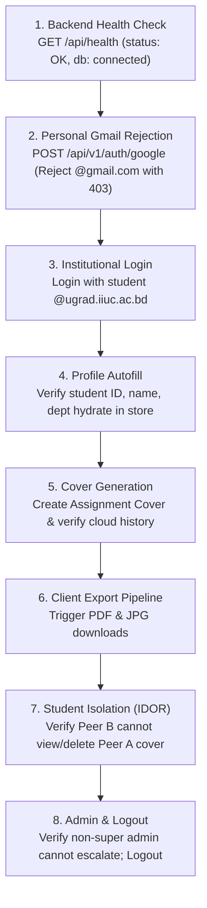

# Phase 7 — Staging Deployment Preparation & Verification Plan

**Document ID:** `PHASE_7_STAGING_DEPLOYMENT_PLAN`  
**Date:** October 19, 2026  
**Repository:** `iiuc-cover-page`  
**Branch:** `migration/firebase-zero-loss`  
**Primary Database Architecture Decision:** Choice A (MongoDB Atlas Source of Truth Preserved)  
**Status:** **PLAN COMPLETE — AWAITING USER APPROVAL**

---

## 1. Executive Summary & Safeguards Verification

In accordance with Phase 7 instructions, this document outlines an isolated, zero-risk staging deployment preparation plan for the **IIUC Cover Page Platform** (React 19 + Node/Express + MongoDB Atlas).

### Mandatory Preservation Safeguards Maintained:
- **Zero Cloud Deployments Executed:** No deployments were triggered to Vercel, Render, Firebase, or any cloud platform.
- **Zero Cloud Setting Modifications:** Production environment variables, domains, and secrets remain untouched.
- **Zero Database Writes:** Production MongoDB Atlas cluster (`iiuc_cover_page`) was not accessed or modified.
- **Credential Hygiene:** No secrets, passwords, or connection strings are printed or logged in this report.
- **Historical Preservation:** All Git branches, tags, migration scripts, emulator tests, and backups are 100% preserved.
- **Zero Financial Commitment:** No new cloud subscriptions or paid tiers were provisioned.

---

## 2. Repository Deployment Configuration Audit

### 2.1 Backend Deployment Parameters (Render Web Service)
- **Documented Reference:** `RENDER_DEPLOYMENT.md`
- **Root Directory:** `backend`
- **Build Command:** `npm install`
- **Start Command:** `node src/server.js` (or `npm start`)
- **Health Check Path:** `/api/health` (also mounted at `/health`, `/api/v1/health`, `/`)
  - Expected Response: `HTTP 200 { "status": "OK", "environment": "staging", "database": "connected" }`
- **Required Backend Environment Variables:**
  - `NODE_ENV`: Set to `staging` (enables staging isolation gates & structured logging).
  - `PORT`: Set to `5000` (Render dynamically routes HTTP/HTTPS).
  - `MONGODB_URI`: Must target an isolated staging database (e.g., `.../iiuc_cover_page_staging`).
  - `JWT_SECRET`: High-entropy 64+ char random secret (distinct from production).
  - `JWT_EXPIRES_IN`: `7d`
  - `GOOGLE_CLIENT_ID`: Authorized Google OAuth 2.0 Web Client ID.
  - `GOOGLE_CLIENT_SECRET`: Optional server-side secret (if required by cloud console).
  - `FRONTEND_URL`: Staging Vercel URL (e.g., `https://iiuc-cover-page-staging.vercel.app` or preview URL).

### 2.2 Frontend Deployment Parameters (Vercel SPA)
- **Configuration File:** `frontend/vercel.json` (SPA URL rewrite to `/index.html`).
- **Build Command:** `npm run build` (or `npm run build:staging`).
- **Output Directory:** `dist`
- **API URL Resolution Logic:** `frontend/src/config/apiConfig.js`
  - Reads `import.meta.env.VITE_API_URL` and normalizes trailing slashes + `/api/v1` suffixing.
- **Required Frontend Environment Variables:**
  - `VITE_API_URL`: Points to Render staging endpoint (e.g., `https://<render-staging-service>.onrender.com/api/v1`).
  - `VITE_GOOGLE_CLIENT_ID`: Matches `GOOGLE_CLIENT_ID` configured in backend.

---

## 3. Evidence of Existing Staging Infrastructure

An audit across backend source files, configuration manifests, and environment examples reveals:
- **Staging Frontend Evidence:** Present in `frontend/package.json` (`build:staging`), `frontend/src/config/firebase.js` (`STAGING_PROJECT_ID = 'iiuc-cover-page-staging'`), and `validate_firebase_config.test.mjs`.
- **Staging Backend / Database Evidence:** **NONE.**
  - There is **no evidence** of an existing live staging Render service in the codebase.
  - There is **no secondary connection string** or pre-existing staging MongoDB database reference in `backend/.env` or `.env.example`.
  - The repository currently only configures production (`iiuc_cover_page`) and local development (`http://localhost:5000`).

---

## 4. Staging Environment Checklist & Isolation Verification

| Staging Resource | Recommended Specification | Isolation & Verification Requirement | Status |
| :--- | :--- | :--- | :--- |
| **Staging Database** | MongoDB Atlas Cluster `cluster0` | Must use a distinct database name: `iiuc_cover_page_staging`. Must **never** share collections with `iiuc_cover_page`. | **CHECKLIST READY** |
| **Database Isolation Gate** | `backend/src/config/validateEnv.js` | Programmatic fail-closed check: if `NODE_ENV === 'staging'` and URI path is `iiuc_cover_page`, the backend refuses to boot. | **VERIFIED (38/38 PASS)** |
| **Backend Service** | Render Free or Starter Web Service | Service name: `iiuc-cover-page-backend-staging`. Root: `backend`, build: `npm install`, start: `node src/server.js`. | **CHECKLIST READY** |
| **Frontend Deployment** | Vercel Preview or Staging Project | Branch preview from `migration/firebase-zero-loss` or separate project `iiuc-cover-page-staging.vercel.app`. | **CHECKLIST READY** |
| **CORS Allowlist** | `backend/src/config/corsConfig.js` | Backend `FRONTEND_URL` configured to Vercel staging domain. Normalizes trailing slashes, blocks unauthorized origins with 403. | **VERIFIED** |
| **Google OAuth Client** | Google Cloud Console OAuth 2.0 | Add staging Vercel origin and staging Render callback to Authorized JavaScript Origins and Redirect URIs. | **CHECKLIST READY** |
| **Institutional Email Gate**| `backend/src/services/emailService.js` | Strictly rejects non-IIUC emails (`@ugrad.iiuc.ac.bd`, `@student.iiuc.ac.bd`, `@iiuc.ac.bd`). | **VERIFIED** |
| **Session Security** | `backend/src/controllers/authController.js`| Distinct `JWT_SECRET`, 7d access, 30d refresh. Refresh tokens hashed in staging DB. | **VERIFIED** |
| **Diagnostic Logging** | `backend/src/utils/logger.js` | Structured JSON output with automatic redaction of passwords, tokens, cookies, and URIs. | **VERIFIED** |

---

## 5. Prevention of Accidental Production Database Mutation

To guarantee zero accidental contamination of production MongoDB data during staging setup:
1. **Programmatic Fail-Closed Gate (`validateEnv.js`):**  
   Added and verified in Phase 7:
   ```javascript
   const isStaging = process.env.NODE_ENV === 'staging' || process.env.APP_ENV === 'staging';
   if (isStaging && mongoUri) {
     const dbNameMatch = mongoUri.match(/\/([^/?]+)(?:\?|$)/);
     const dbName = dbNameMatch ? dbNameMatch[1] : '';
     if (dbName === 'iiuc_cover_page') {
       missing.push('✗ DATABASE ISOLATION — Staging cannot target production database "iiuc_cover_page"');
     }
   }
   ```
2. **Database Suffix Requirement:** The staging connection string must explicitly append `_staging` to the database name (e.g. `/iiuc_cover_page_staging?retryWrites=true&w=majority`).
3. **Automated Unit Verification:** Suite 5 in `tests/security_hardening.test.mjs` validates that any attempt to boot a staging environment with the production database name is immediately aborted.

---

## 6. Manual Staging Smoke-Test Plan

Following staging deployment, execute the following non-destructive 8-step smoke test using isolated test accounts:



### Detailed Smoke-Test Execution Matrix

| Test Step | Action / Endpoint | Expected Outcome | Verification Method |
| :--- | :--- | :--- | :--- |
| **1. Health & DB Check** | `GET https://<staging-render-url>/api/health` | `HTTP 200 {"status":"OK","environment":"staging","database":"connected"}` | Curl / Browser request |
| **2. Non-Academic Rejection** | Attempt login with personal `@gmail.com` account | `HTTP 403 Forbidden` ("Only official IIUC academic accounts authorized") | Frontend error toast |
| **3. Institutional Sign-in** | Sign in with `@ugrad.iiuc.ac.bd` test account | `HTTP 200`, JWT tokens issued, user redirected to `/dashboard` | Google OAuth popup & store check |
| **4. Profile Hydration** | Open `/create` generator page | Student Name, Student ID, and Department autofilled in generator forms | UI form inspection |
| **5. Cover Creation** | Generate and save an Assignment Cover | `HTTP 201`, saved cover appears in Cover History table | UI Cover History view |
| **6. PDF / JPG Export** | Click "Download PDF" and "Download JPG" | File downloads to browser; 210mm x 297mm A4 aspect ratio preserved | Client PDF viewer |
| **7. IDOR Isolation** | Attempt to `GET /api/v1/covers/:id` belonging to Student A using Student B's token | `HTTP 404 Not Found` (Cover query scoped strictly to `userId`) | API test |
| **8. Logout & Revocation** | Click "Logout" in header | `HTTP 200`, session cleared, refresh token invalidated in DB | UI state check |

---

## 7. Status Summary & Next Actions

### 7.1 Confirmed Existing Infrastructure
- Production MongoDB Atlas Cluster with canonical verified backup.
- Production Vercel Frontend (`https://iiuccoverpage.vercel.app`).
- Comprehensive local test suites (38 backend security tests, 24 frontend config tests, clean Vite production build).

### 7.2 Missing Staging Resources (To be created upon approval)
1. **Staging MongoDB Database:** `iiuc_cover_page_staging` on MongoDB Atlas.
2. **Staging Render Web Service:** `iiuc-cover-page-backend-staging` on Render Dashboard.
3. **Staging Vercel URL:** Preview deployment URL or `iiuc-cover-page-staging.vercel.app`.
4. **Google Cloud Console Staging Credentials:** Staging URL added to Authorized Origins in Google Cloud Console.

### 7.3 Exact Actions Requiring User Approval
- **Approval Item 1:** Authorization to create the `iiuc_cover_page_staging` database on MongoDB Atlas.
- **Approval Item 2:** Authorization to configure a staging Web Service on Render (`iiuc-cover-page-backend-staging`).
- **Approval Item 3:** Authorization to deploy a Vercel preview deployment linked to branch `migration/firebase-zero-loss`.
- **Approval Item 4:** Authorization to add staging origins to Google Cloud Console OAuth 2.0 client.

### 7.4 Safe Deployment Sequence (Once Approved)
1. **Phase 7A:** Create empty `iiuc_cover_page_staging` database on Atlas and seed academic courses/teachers (no user covers).
2. **Phase 7B:** Create Render staging Web Service with `NODE_ENV=staging`, isolated `MONGODB_URI`, distinct `JWT_SECRET`, and staging `FRONTEND_URL`.
3. **Phase 7C:** Deploy Vercel frontend with `VITE_API_URL` pointing to the Render staging service.
4. **Phase 7D:** Update Google Cloud Console with staging URLs.
5. **Phase 7E:** Execute the 8-step smoke test plan.
6. **Phase 7F:** Review smoke test results before any production cutover decision.
